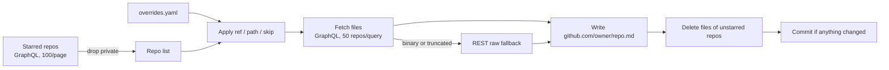

# starred-readmes

[](https://github.com/Insulinocytus/starred-readmes/actions/workflows/sync.yml)

A weekly GitHub Actions job that mirrors the README of every public repository I have starred into this repo, one file per repository:

```
github.com/<owner>/<repo>.md
```

Use it for full-text search (`grep -ri "keyword" github.com/`), as LLM/RAG input, or as a git-tracked history of how those READMEs change. Files are stored verbatim, with no added metadata.

> [!NOTE]
> Everything under `github.com/` is copied from the respective upstream projects and remains under their copyright and licenses. The [MIT license](LICENSE) covers only this repository's own code and configuration (`.github/`, `overrides.yaml`, this README).

## How it works



- Fetches exactly `README.md` (case-sensitive) at the root of the default branch, unless `overrides.yaml` says otherwise.
- Private stars are skipped, so nothing private ends up in a public repo.
- Files of repos that are no longer starred (or no longer have the file) are deleted; old versions stay in git history.
- Any request error after 2 retries fails the whole run with nothing committed, so a network blip never deletes files.
- A full sync of ~1,450 repos takes about 45 sequential HTTP requests and ~16 GraphQL rate-limit points.

The job runs every Sunday at 03:00 UTC and can be triggered manually. Each run writes a job summary listing repos without a `README.md`, broken overrides, and overrides for repos you no longer star.

## Use it for your own stars

1. **Fork** this repository, then enable workflows in the fork's **Actions** tab (GitHub disables them on forks by default).

2. **Create a fine-grained personal access token** at [Settings → Developer settings → Fine-grained tokens](https://github.com/settings/personal-access-tokens/new):
   - Repository access: **Public repositories** (read-only)
   - Account permissions: **Starring → Read-only**

3. **Store it as a secret** named `STARS_TOKEN`:

   ```sh
   gh secret set STARS_TOKEN -R <you>/starred-readmes
   ```

4. **Disable push protection** for the repository:

   ```sh
   gh api -X PATCH repos/<you>/starred-readmes \
     -f "security_and_analysis[secret_scanning_push_protection][status]=disabled"
   ```

> [!IMPORTANT]
> Upstream READMEs often contain example tokens or webhook URLs. GitHub push protection treats those as leaked secrets and rejects the bot's push, failing the whole sync. Secret scanning alerts still show up under the repository's **Security** tab after you disable push protection.

5. **Clear my overrides** by emptying `overrides.yaml` (keep the comment header), since they are tailored to my stars.

6. **Run it**:

   ```sh
   gh workflow run sync -R <you>/starred-readmes
   ```

   The first run replaces my mirrored files with yours. Check the job summary for repos that need an override.

## Overrides

`overrides.yaml` handles repos whose README isn't a root `README.md` on the default branch. Keys use the same `github.com/<owner>/<repo>` form as the output paths:

```yaml
github.com/AvaloniaUI/Avalonia:
  path: readme.md        # file to fetch (default: README.md)
github.com/foo/bar:
  ref: docs              # branch, tag or commit (default: default branch)
  path: docs/index.md
github.com/baz/qux:
  skip: true             # don't mirror this repo
```

The output is always `github.com/<owner>/<repo>.md`, whatever the source file's extension. To find the file GitHub itself renders as a repo's README:

```sh
gh api repos/<owner>/<repo>/readme --jq .path
```

## Run locally

```sh
pip install pyyaml
GH_TOKEN=$(gh auth token) python .github/scripts/sync.py
```

Without `GITHUB_STEP_SUMMARY` set, the summary prints to stdout.

## Maintenance notes

- **Token expiry:** fine-grained tokens expire, at most after one year. Renew the token and run `gh secret set STARS_TOKEN` again when GitHub emails you.
- **Inactive repos:** GitHub disables scheduled workflows after 60 days without repository activity. Weekly README changes usually keep it alive; if not, re-enable the workflow in the Actions tab.
